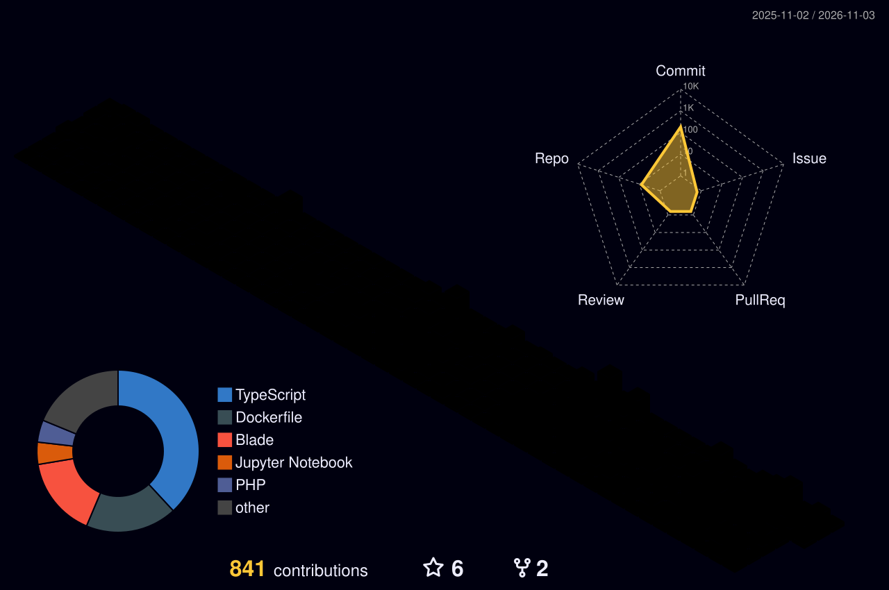

<!-- ===================== HEADER 3D / ANIMASI ===================== -->
<div align="center">


<a href="https://github.com/Ryuushu">
  
</a>

<br/>


</div>

---

## 👨‍💻 Tentang Saya


```js
const saya = {
  username: "Ryuushu",
  alias: "🍀 NIXIE",
  status: "Beginner Programmer 😁",
  motto: "My code made with 🧠",
  zonaWaktu: "UTC+07:00 (WIB) 🇮🇩",
  komunitas: "infinityDev12",
  sedangDipelajari: ["Web Development", "Flutter", "Bot JavaScript"],
  achievements: ["🦈 Pull Shark x3", "⚡ Quickdraw"],
  funFact: "Kopi dulu, baru commit ☕",
};
```

- 🔭 Sedang membangun proyek **web, bot, dan aplikasi mobile**
- 🌱 Terus belajar **PHP, JavaScript, dan Flutter (Dart)**
- 👯 Terbuka untuk **kolaborasi dan belajar bareng**
- 🏅 Meraih badge **Pull Shark ×3** dan **Quickdraw** di GitHub
- 🌐 Lihat portofolio saya: [portfolioil.thecapz.com](http://portfolioil.thecapz.com/) · [authorportfolio.nixie.my.id](https://authorportfolio.nixie.my.id/)

<br clear="right"/>

---

## 🛠️ Tech Stack

<div align="center">

<a href="https://skillicons.dev">
  
</a>

</div>

---

## 🧊 Grafik Kontribusi 3D

<div align="center">

<!-- Dihasilkan otomatis oleh GitHub Actions (.github/workflows/profile-3d.yml) -->


</div>

> 💡 *Grafik 3D di atas dibuat otomatis setiap hari lewat GitHub Actions.*

---

## 📊 Statistik GitHub

<div align="center">


<br/><br/>

<a href="https://github.com/Ryuushu?tab=repositories"></a>
<a href="https://github.com/Ryuushu?tab=stars"></a>
<a href="https://github.com/Ryuushu?tab=achievements"></a>
<a href="https://github.com/Ryuushu?tab=achievements"></a>

<br/><br/>


</div>

---

## 🚀 Proyek Pilihan

<div align="center">

| Proyek | Bahasa |
|:------:|:-------|
| [**Absensi-RFID**](https://github.com/Ryuushu/Absensi-RFID) | `CSS` |
| [**yorukami-bot-js**](https://github.com/Ryuushu/yorukami-bot-js) | `JavaScript` |
| [**cvweb**](https://github.com/Ryuushu/cvweb) | `HTML` |
| [**cv_mvc_cus**](https://github.com/Ryuushu/cv_mvc_cus) | `JavaScript` |
| [**testflut**](https://github.com/Ryuushu/testflut) | `Dart` |
| [**webfolio**](https://github.com/Ryuushu/webfolio) *(fork dari InfinityDev12)* | `PHP` |

</div>

---

## 🎮 Bagian Interaktif

<details>
<summary><b>🏅 Klik untuk melihat pencapaian</b></summary>
<br/>

- 🦈 **Pull Shark ×3** — pull request yang di-merge
- ⚡ **Quickdraw** — menutup issue/PR dalam waktu singkat

[Lihat semua achievement →](https://github.com/Ryuushu?tab=achievements)

</details>

<details>
<summary><b>🎯 Klik untuk melihat target saya</b></summary>
<br/>

- [x] Membuat profil GitHub yang menarik
- [x] Meraih badge Pull Shark & Quickdraw
- [ ] Menyelesaikan proyek Flutter pertama
- [ ] Membuat bot JavaScript yang makin canggih
- [ ] Berkontribusi ke lebih banyak proyek open source

</details>

---

## 🤝 Mari Terhubung

<div align="center">

<a href="http://portfolioil.thecapz.com/"></a>
<a href="https://authorportfolio.nixie.my.id/"></a>
<a href="https://github.com/Ryuushu"></a>

</div>

---

<div align="center">

### ⭐ Kalau suka profil ini, jangan lupa kasih bintang di repo favoritmu! ⭐


</div>
